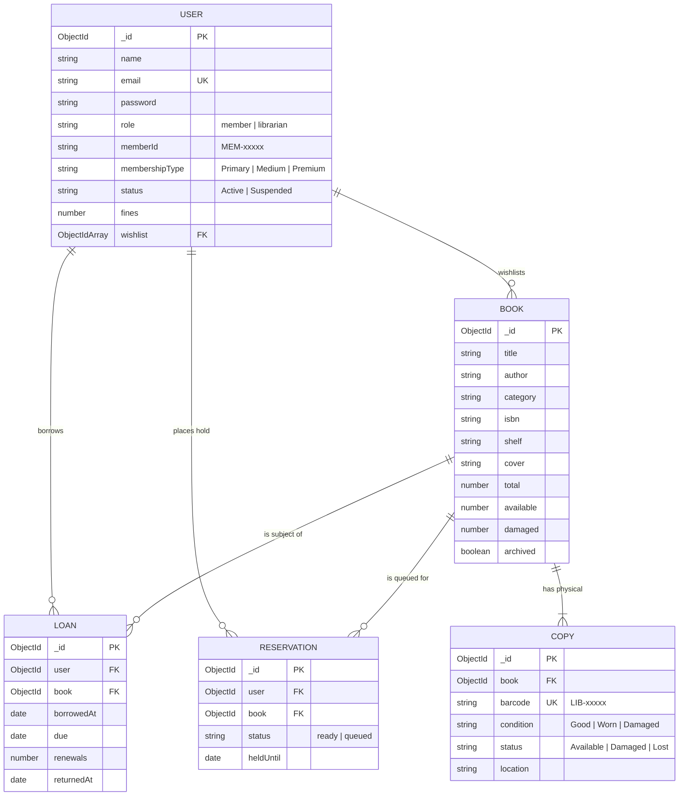

# ⚙️ Reader's Room - Backend REST API

> A robust, secure Express 5 and MongoDB backend powering catalog lifecycle management, copy-level barcode inventory, circulation loans, hold queues, and fine administration.

[](https://nodejs.org/)
[](https://expressjs.com/)
[](https://www.mongodb.com/)
[](https://mongoosejs.com/)
[](https://jwt.io/)
[](https://github.com/dcodeIO/bcrypt.js)

---

## 📖 Table of Contents

- [Overview](#-overview)
- [Architecture & Design Principles](#-architecture--design-principles)
- [Database Models & Relationships](#-database-models--relationships)
- [Authentication & Access Control](#-authentication--access-control)
- [Business Logic & Circulation Guardrails](#-business-logic--circulation-guardrails)
- [Complete REST API Reference](#-complete-rest-api-reference)
  - [Health & Diagnostics](#1-health--diagnostics)
  - [Authentication & Profile (`/api/auth`)](#2-authentication--profile-apiauth)
  - [Catalog & Physical Copies (`/api/books`)](#3-catalog--physical-copies-apibooks)
  - [Member Circulation & Library (`/api/library`)](#4-member-circulation--library-apilibrary)
  - [Librarian Dashboard & Analytics (`/api/librarian`)](#5-librarian-dashboard--analytics-apilibrarian)
  - [Member Administration & Fines (`/api/members`)](#6-member-administration--fines-apimembers)
- [Setup & Running](#-setup--running)
  - [Prerequisites](#prerequisites)
  - [Installation](#installation)
  - [Environment Configuration](#environment-configuration)
  - [Database Seeding](#database-seeding)
  - [Available Scripts](#available-scripts)
- [Error Handling & Response Standards](#-error-handling--response-standards)

---

## 🌟 Overview

The **Reader's Room Backend** provides a high-reliability, JSON-over-HTTP RESTful API servicing both client web portals and administrative tools. Built with modern ES Modules on **Express 5** and **Mongoose 9**, it manages inventory state, circulation rules, fine ledgers, and atomic counter updates.

---

## 🏗️ Architecture & Design Principles

- **ES Modules Native**: Modern JavaScript syntax throughout (`import`/`export`), configured via `"type": "module"` in `package.json`.
- **Stateless Authentication**: Session state is managed purely through signed JSON Web Tokens (JWT) containing user identifiers and verified on each request.
- **Layered Structure**:
  - `config/`: MongoDB connection setup via Mongoose.
  - `middleware/`: JWT authentication verification and role-based authorization gates (`protect`, `librarianOnly`, `memberOnly`).
  - `models/`: Strictly typed Mongoose schemas for books, copies, loans, reservations, and patrons.
  - `routes/`: Modularized express routers handling controller logic and validation.
- **Atomic Database Operations**: Multi-copy updates, checkout availability decrements, and return increments leverage MongoDB atomic operators (`$inc`, `$gt`, `findOneAndUpdate`) to eliminate race conditions.

---

## 🗄️ Database Models & Relationships

The database consists of 5 interconnected collections:



---

## 🔐 Authentication & Access Control

Authentication uses HTTP Bearer tokens:
```http
Authorization: Bearer <your_jwt_token>
```

### Authorization Middleware (`middleware/auth.js`)
1. **`protect`**: Validates the Bearer token against `JWT_SECRET`, loads the matching User document from MongoDB (excluding password hash), and binds it to `req.user`.
2. **`librarianOnly`**: Blocks any user whose `req.user.role !== "librarian"` with `403 Forbidden`.
3. **`memberOnly`**: Blocks any user whose `req.user.role !== "member"` with `403 Forbidden`.

---

## ⚖️ Business Logic & Circulation Guardrails

| Constraint | Rule Specification |
| :--- | :--- |
| **Borrowing Limit** | A member can borrow at most **5 active books** concurrently (`returnedAt: null`). |
| **Loan Period** | Loans are issued for a standard duration of **14 days**. |
| **Renewals** | Loans can be renewed up to **2 times** (+7 days per renewal). Overdue loans cannot be renewed. |
| **Copy Deletion Safety** | A book title cannot be deleted if it has active loans or pending reservations. Librarians are instructed to archive it instead. |
| **Copy Consistency** | Marking a physical copy as `Damaged` or `Lost` decrements the book's `available` stock and increments `damaged`. Copies cannot be marked damaged if all available copies are currently out on loan. |
| **Member ID Format** | Automatically assigned sequential identifiers starting at `MEM-99201`. |
| **Copy Barcode Format** | Unique zero-padded sequential barcodes formatted as `LIB-00001`, `LIB-00002`, etc. |

---

## 📡 Complete REST API Reference

All requests and responses use `application/json`. Authenticated routes require an `Authorization: Bearer <token>` header.

### 1. Health & Diagnostics

#### `GET /api/health`
Checks whether the API server is operational.
- **Access**: Public
- **Response `200 OK`**:
  ```json
  { "ok": true }
  ```

---

### 2. Authentication & Profile (`/api/auth`)

#### `POST /api/auth/signup`
Creates a new patron account with an auto-assigned Member ID (`MEM-xxxxx`).
- **Access**: Public
- **Body**:
  ```json
  {
    "name": "Jane Doe",
    "email": "jane@example.com",
    "password": "securepassword123"
  }
  ```
- **Response `201 Created`**:
  ```json
  {
    "message": "Account created.",
    "user": {
      "_id": "6724...",
      "name": "Jane Doe",
      "email": "jane@example.com",
      "role": "member",
      "memberId": "MEM-99203"
    }
  }
  ```

#### `POST /api/auth/login`
Authenticates credentials and returns a signed JWT.
- **Access**: Public
- **Body**:
  ```json
  {
    "email": "jane@example.com",
    "password": "securepassword123"
  }
  ```
- **Response `200 OK`**:
  ```json
  {
    "token": "eyJhbGciOiJIUzI1NiIsInR5c...",
    "user": {
      "_id": "6724...",
      "name": "Jane Doe",
      "email": "jane@example.com",
      "role": "member",
      "memberId": "MEM-99203"
    }
  }
  ```

#### `GET /api/auth/me`
Retrieves the logged-in user profile.
- **Access**: Authenticated (`protect`)
- **Response `200 OK`**: Returns user document without password.

#### `PUT /api/auth/me`
Updates user contact and profile details.
- **Access**: Authenticated (`protect`)
- **Body**: `{ "name": "Jane D.", "email": "new@example.com", "phone": "555-0199", "preferredName": "Janey" }`

#### `PUT /api/auth/password`
Updates password after verifying the existing one.
- **Access**: Authenticated (`protect`)
- **Body**: `{ "current": "securepassword123", "next": "newsecretpassword88" }`

---

### 3. Catalog & Physical Copies (`/api/books`)

#### `GET /api/books`
Lists books. Regular members only receive unarchived books; librarians receive all books including archived.
- **Access**: Authenticated (`protect`)

#### `POST /api/books`
Registers a new book and creates its corresponding physical copy records with sequential barcodes.
- **Access**: Librarian Only
- **Body**:
  ```json
  {
    "title": "Cosmic Explorations",
    "author": "Dr. Sarah Vance",
    "category": "Science",
    "isbn": "9781234500001",
    "shelf": "D-04",
    "copies": 3,
    "year": 2024,
    "publisher": "Astra Press"
  }
  ```
- **Response `201 Created`**: Returns newly created Book document.

#### `POST /api/books/bulk`
Bulk import an array of books from CSV or JSON.
- **Access**: Librarian Only
- **Body**: `{ "books": [ { "title": "Book 1", "author": "Author 1", "copies": 2 } ] }`
- **Response `200 OK`**: `{ "created": 1, "skipped": 0 }`

#### `PUT /api/books/:id`
Updates book title, author, category, shelf, and metadata.
- **Access**: Librarian Only

#### `PATCH /api/books/:id/archive`
Toggles the `archived` boolean flag.
- **Access**: Librarian Only

#### `DELETE /api/books/:id`
Deletes a title if it has 0 active loans and 0 reservations. Removes associated copy documents.
- **Access**: Librarian Only

#### `GET /api/books/:id/copies`
Retrieves all physical copy documents (`LIB-xxxxx`) associated with the title.
- **Access**: Librarian Only

#### `POST /api/books/:id/copies`
Creates a single physical copy for a book with a newly generated barcode.
- **Access**: Librarian Only
- **Body**: `{ "condition": "Good", "location": "Shelf D-04" }`

#### `PATCH /api/books/copies/:copyId`
Modifies copy status (`Available`, `Damaged`, `Lost`), condition (`Good`, `Worn`, `Damaged`), or location.
- **Access**: Librarian Only

#### `DELETE /api/books/copies/:copyId`
Removes a specific physical copy and decrements book stock counters.
- **Access**: Librarian Only

---

### 4. Member Circulation & Library (`/api/library`)

#### `GET /api/library`
Fetches all library data for the logged-in member: active loans, reading history, queued reservations with position numbers, and wishlist IDs.
- **Access**: Member Only (`memberOnly`)

#### `POST /api/library/borrow/:id`
Borrows an available copy of a book. Sets 14-day due date and decrements available count.
- **Access**: Member Only (`memberOnly`)

#### `POST /api/library/renew/:id`
Extends loan due date by +7 days. Increments renewal counter. Rejects if overdue or renewals >= 2.
- **Access**: Member Only (`memberOnly`)

#### `POST /api/library/return/:id`
Marks loan as returned (`returnedAt = Date.now()`) and increments book availability.
- **Access**: Member Only (`memberOnly`)

#### `POST /api/library/reserve/:id`
Queues a reservation when no copies are currently available.
- **Access**: Member Only (`memberOnly`)

#### `DELETE /api/library/reserve/:id`
Cancels an existing reservation.
- **Access**: Member Only (`memberOnly`)

#### `POST /api/library/pickup/:id`
Claims a ready reservation and converts it into an active 14-day loan.
- **Access**: Member Only (`memberOnly`)

#### `POST /api/library/wishlist/:id`
Toggles book presence in the patron's personal wishlist.
- **Access**: Member Only (`memberOnly`)

---

### 5. Librarian Dashboard & Analytics (`/api/librarian`)

#### `GET /api/librarian/dashboard`
Aggregates comprehensive system metrics:
- **Stats**: Total titles, total physical copies, active loans, member count, overdue loans, pending holds.
- **Overdue Ledger**: Loans past due with calculated overdue day count and suggested action.
- **Reservations Queue**: Top holds with patron names and timestamps.
- **Recent Transactions**: Real-time checkout and return events.
- **Activity Trends**: 6-day borrowing and return counts for chart visualization.
- **Low Stock**: Alert for titles with 1 or 0 copies remaining.
- **Access**: Librarian Only

---

### 6. Member Administration & Fines (`/api/members`)

#### `GET /api/members`
Lists all members alongside their active loan counts.
- **Access**: Librarian Only

#### `POST /api/members`
Enrolls a new member directly from the librarian desk.
- **Access**: Librarian Only
- **Body**: `{ "name": "David Miller", "email": "david@example.com", "password": "tempPassword123", "type": "Primary", "phone": "555-4321" }`

#### `PUT /api/members/:id`
Updates member contact information and membership tier.
- **Access**: Librarian Only

#### `PATCH /api/members/:id/status`
Toggles member status between `Active` and `Suspended`.
- **Access**: Librarian Only

#### `PATCH /api/members/:id/fines`
Updates or clears a member's fine balance.
- **Access**: Librarian Only
- **Body**: `{ "fines": 12.50 }`

#### `GET /api/members/:id/details`
Retrieves a detailed analytical dossier for a member: active loans, reservations, annual borrow volume, and average return duration in days.
- **Access**: Librarian Only

---

## ⚡ Setup & Running

### Prerequisites
- Node.js `18.0.0` or higher
- MongoDB instance (local or MongoDB Atlas)

### Installation

```bash
cd Backend
npm install
```

### Environment Configuration

Copy the template `.env.example`:
```bash
cp .env.example .env
```

Configure your environment settings:
```env
PORT=5000
JWT_SECRET=your_jwt_secret_key_change_in_production
MONGO_URI=mongodb://localhost:27017/readersroom
```

### Database Seeding

Populate the database with initial catalog titles, librarian credentials, and demo patron accounts:
```bash
npm run seed
```

Output confirmation:
```text
Seeded. Librarian: marcus@library.org / librarian123  |  Member: alexander@example.com / password123
Database: readersroom | books: 10 | users: 2
```

### Available Scripts

| Command | Action |
| :--- | :--- |
| `npm run dev` | Runs the API server with `nodemon` for auto-reloading on file changes |
| `npm run seed` | Resets and repopulates the MongoDB collections with sample data |
| `npm test` | Placeholder for automated unit & integration test suites |

---

## 🛡️ Error Handling & Response Standards

All error responses return standard JSON envelopes with descriptive HTTP status codes:

```json
{
  "message": "Specific explanation of the error."
}
```

### Common HTTP Status Codes Used:
- `200 OK`: Request succeeded.
- `201 Created`: Resource successfully created.
- `400 Bad Request`: Validation failure or business constraint violation (e.g. borrow limit reached).
- `401 Unauthorized`: Missing, invalid, or expired Bearer token.
- `403 Forbidden`: Insufficient role privileges for the requested endpoint.
- `404 Not Found`: Target resource does not exist.
- `409 Conflict`: Unique constraint violation (e.g. duplicate email address).
- `500 Internal Server Error`: Unhandled server-side exception.
