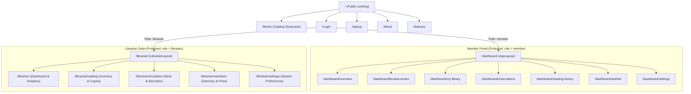

# 🎨 Reader's Room - Frontend Client

> An elegant, high-performance single page application built with React 19, Vite, and Tailwind CSS v4, delivering specialized experiences for library patrons and administrators.

[](https://react.dev/)
[](https://vitejs.dev/)
[](https://tailwindcss.com/)
[](https://reactrouter.com/)
[](https://recharts.org/)
[](https://lucide.dev/)

---

## 📖 Table of Contents

- [Overview](#-overview)
- [Architecture & Tech Highlights](#-architecture--tech-highlights)
- [Application Flow & Routes](#-application-flow--routes)
- [State Management & API Communication](#-state-management--api-communication)
- [Directory Structure](#-directory-structure)
- [Page & Feature Deep Dive](#-page--feature-deep-dive)
  - [Public & Marketing Pages](#1-public--marketing-pages)
  - [Member Portal Pages](#2-member-portal-pages)
  - [Librarian Administration Pages](#3-librarian-administration-pages)
- [Setup & Development](#-setup--development)
  - [Prerequisites](#prerequisites)
  - [Installation](#installation)
  - [Environment Configuration](#environment-configuration)
  - [Available Scripts](#available-scripts)
- [Styling & Design System](#-styling--design-system)
- [Troubleshooting & FAQs](#-troubleshooting--faqs)

---

## 🌟 Overview

The **Reader's Room Frontend** provides an interface with clean typography, cinematic video integration, and role-tailored dashboards. It serves two distinct personas:
1. **The Library Patron (Member)**: Focuses on book discovery, loan tracking, reading history, and self-service borrowing and reservation workflows.
2. **The Librarian (Admin)**: Operates a comprehensive desk for inventory lifecycle, barcode-level physical copy management, circulation handling, fine assessment, and patron account governance.

---

## 🛠️ Architecture & Tech Highlights

- **React 19 Core**: Leveraging React 19 primitives with functional components, hooks (`useCallback`, `useMemo`, `useRef`, `useState`, `useEffect`), and Context API.
- **Vite 8 Build Tooling**: Fast Hot Module Replacement (HMR) and optimized Rollup production bundling.
- **Tailwind CSS v4 Engine**: Utilizes `@tailwindcss/vite` plugin for modern CSS compilation and glassmorphic styling without legacy config overhead.
- **Client-Side Routing via React Router v7**: Layout nesting, redirect fallbacks, and fine-grained `ProtectedRoute` guards for member and librarian role validation.
- **Data Visualizations**: Responsive charts using Recharts for weekly checkout volumes and reading velocity.

---

## 🗺️ Application Flow & Routes

The client enforces role-based access control directly in the router tree:



---

## 🔄 State Management & API Communication

### 1. `LibraryContext` (`src/context/LibraryContext.jsx`)
Centralizes all real-time patron state and action dispatchers:
- **State Properties**: `user`, `loans`, `reservations`, `history`, `wishlist`, `dark` theme, and active `toast` messages.
- **Action Dispatchers**:
  - `borrow(id)`: Initiates checkout with instantaneous UI refresh.
  - `renew(id)`: Requests loan extension.
  - `returnBook(id)`: Processes return and updates availability counters.
  - `reserve(id)` / `cancelReservation(id)` / `pickUp(id)`: Full reservation queue lifecycle.
  - `toggleWishlist(id)`: Adds or removes books from personal wishlist.
- **Calculated Helpers**:
  - `daysLeft(iso)`: Computes remaining days until due date.
  - `loanStatus(due)`: Yields badge tone (`green`, `warn`, `red`) and label text (`Due in X days`, `Due today`, `Overdue by X days`).
  - `loanProgress(loan)`: Computes percentage elapsed of the borrowing window.

### 2. API Client (`src/api.js`)
An abstraction over native `fetch`:
- Injects JWT `Bearer` token from `localStorage.getItem("rr_token")`.
- Sets standard `Content-Type: application/json` headers.
- Handles HTTP error status codes and session invalidation triggers.

---

## 📁 Directory Structure

```text
Frontend/
├── public/
│   ├── favicon.svg             # Application logo
│   ├── icons.svg               # SVG icons
│   └── lib.MP4                 # Cinematic background video for landing page
├── src/
│   ├── components/             # Common layouts & presentation components
│   │   ├── About.jsx           # About page with library mission
│   │   ├── AppLayout.jsx       # Member layout (Navbar + Sidebar + Outlet)
│   │   ├── AuthContext.jsx     # Legacy auth wrapper
│   │   ├── ExploreBooks.jsx    # Public catalog search page
│   │   ├── Features.jsx        # Platform capabilities showcase
│   │   ├── LibrarianLayout.jsx # Librarian navigation shell & topbar
│   │   ├── Login.jsx           # User & librarian login form
│   │   ├── Navbar.jsx          # Public sticky header with theme switch
│   │   ├── Page.jsx            # Landing page with video background
│   │   ├── ProtectedRoute.jsx  # Route guard checking role & token
│   │   ├── Sidebar.jsx         # Responsive patron navigation bar
│   │   ├── Signup.jsx          # Member registration form
│   │   └── ui.jsx              # Reusable UI primitives (Buttons, Badges)
│   ├── context/
│   │   └── LibraryContext.jsx  # Global patron state & action handlers
│   ├── pages/                  # Views mapped to URL routes
│   │   ├── BrowseBooks.jsx     # Member catalog search with borrow actions
│   │   ├── CatalogInventory.jsx# Librarian book & physical copy manager
│   │   ├── CirculationDesk.jsx # Librarian barcode checkout/checkin
│   │   ├── LibrarianDashboard.jsx # Admin metrics & circulation activity
│   │   ├── MembersFines.jsx    # Member roster, fines, and reading metrics
│   │   ├── MyLibrary.jsx       # Member active loans & renewal actions
│   │   ├── Overview.jsx        # Member home dashboard & progress bars
│   │   ├── ReadingHistory.jsx  # Member historical borrowed books ledger
│   │   ├── Reservations.jsx    # Member reservation queue & claim pickup
│   │   ├── Settings.jsx        # Member profile & password update form
│   │   ├── SettingsPreferences.jsx # Librarian system settings
│   │   └── Wishlist.jsx        # Member saved books collection
│   ├── api.js                  # Centralized HTTP request utility
│   ├── App.css                 # Component-specific styles
│   ├── App.jsx                 # Route tree & context provider setup
│   ├── index.css               # Tailwind v4 import & custom CSS theme
│   └── main.jsx                # React root bootstrap
├── .env.example                # Frontend environment template
├── index.html                  # HTML entry point with metadata
├── package.json                # NPM packages & build scripts
└── vite.config.js              # Vite configuration with Tailwind plugin
```

---

## 💻 Page & Feature Deep Dive

### 1. Public & Marketing Pages
- **Landing Page (`Page.jsx`)**: Fullscreen responsive layout featuring a muted looping background video (`/lib.MP4`), dynamic gradients, theme toggle, and direct quick-action portals.
- **Explore Books (`ExploreBooks.jsx`)**: Allows unregistered users to browse and filter books by genre before creating an account.
- **Login (`Login.jsx`) & Signup (`Signup.jsx`)**: Clean form interfaces with client-side validation, password length checks, and error banners.

---

### 2. Member Portal Pages
- **Overview (`Overview.jsx`)**:
  - Highlights loans approaching due dates with progress bars.
  - Active reservation positions (`1st in queue`, etc.).
  - 6-month patron reading activity bar chart.
- **Browse Books (`BrowseBooks.jsx`)**:
  - Grid view of books with colorful gradients matching each book's category.
  - Category filters, live search, shelf badges, and stock availability counters.
  - Instant borrow button (or reserve if unavailable).
- **My Library (`MyLibrary.jsx`)**:
  - Active loan cards with due date warnings, renewal counter (`0/2`, `1/2`, `2/2`), and return book triggers.
- **Reservations (`Reservations.jsx`)**:
  - Displays queued holds with position indices.
  - "Ready for Pickup" cards with an action button to claim the book immediately.
- **Reading History (`ReadingHistory.jsx`)**:
  - Chronological list of returned literature with borrowing and return timestamps.
- **Wishlist (`Wishlist.jsx`)**:
  - Saved titles ready for one-click borrowing once copies become available.
- **Settings (`Settings.jsx`)**:
  - Profile modification (Preferred Name, Email, Phone) and password changes.

---

### 3. Librarian Administration Pages
- **Librarian Dashboard (`LibrarianDashboard.jsx`)**:
  - Metric counters: Total Titles, Physical Copies, Active Loans, Registered Members, Overdue Loans, Pending Reservations.
  - Overdue table with calculated overdue days and action triggers (`Send Notice` or `Mark Lost`).
  - Interactive borrowing vs return activity chart rendered with Recharts.
- **Catalog & Inventory (`CatalogInventory.jsx`)**:
  - Tabular inventory with multi-select filters: Category, Stock Status, Availability, Publisher, Year.
  - Add Title modal with copy count allocation.
  - Copy Inspector: View and edit individual physical copies, update status (`Available`, `Damaged`, `Lost`), modify condition grade (`Good`, `Worn`, `Damaged`), and shelf location.
  - CSV Bulk Importer: Import books via CSV with automatic duplicate checking.
  - CSV Exporter: Download full inventory catalog reports in one click.
- **Circulation Desk (`CirculationDesk.jsx`)**:
  - Barcode terminal simulation with dynamic SVG barcode rendering.
  - Issue Book: Scan Member ID + Copy Barcode (`LIB-xxxxx`) to initiate a checkout.
  - Return Book: Scan Copy Barcode to process returns and flag damaged items.
  - Active Transactions: Live audit of books currently in circulation.
- **Members & Fines (`MembersFines.jsx`)**:
  - Directory of library patrons with search and membership tier filters.
  - Account status toggle: One-click suspension or reinstatement.
  - Fine adjustment modal to add or clear penalty charges.
  - Detailed Member Insights modal: Shows member's active loans, reservations, annual borrow count, and average turnaround time in days.

---

## ⚡ Setup & Development

### Prerequisites
- Node.js `18.0.0` or higher
- npm or pnpm

### Installation

```bash
# Navigate to the frontend directory
cd Frontend

# Install package dependencies
npm install
```

### Environment Configuration

Create a local `.env` file from `.env.example`:

```bash
cp .env.example .env
```

Verify your `.env` contents:
```env
VITE_API_URL=http://localhost:5000
```

### Available Scripts

| Command | Purpose |
| :--- | :--- |
| `npm run dev` | Starts Vite local development server at `http://localhost:5173` |
| `npm run build` | Compiles and optimizes assets into the `dist/` directory |
| `npm run preview` | Runs a local preview of the production `dist/` build |
| `npm run lint` | Executes ESLint to check for code quality and syntax issues |

---

## 🎨 Styling & Design System

The application uses **Tailwind CSS v4** with a dark, reading-room aesthetic:
- **Primary Color Palette**:
  - Backgrounds: Deep forest greens (`#0f1a15`, `#16231c`, `#0E1511`) and subtle charcoal tones.
  - Borders: Emerald muted borders (`#2a3d33`, `#1f6b3f`).
  - Accents: Vibrant emerald (`#38D982`), warm amber (`#FBBF24`), and alert red.
- **Book Cover Aesthetic**:
  - 10 distinct dynamic linear gradient palettes (`from-emerald-900 to-green-600`, `from-amber-800 to-yellow-600`, etc.) assigned deterministically across genres.
- **Dynamic Barcode Generator**:
  - Pure SVG procedural barcode rendering using a deterministic pseudo-random distribution algorithm based on barcode string values.

---

## ❓ Troubleshooting & FAQs

### 1. `Request failed` or Network Errors
- Ensure the backend server is running on `http://localhost:5000`.
- Verify that `VITE_API_URL` in `Frontend/.env` points to the correct backend host.

### 2. Session Expired or Redirect to Login
- Clear stale browser storage if you reseeded the backend database:
  ```javascript
  localStorage.clear();
  ```
- Re-login using one of the seeded demo accounts (`marcus@library.org` or `alexander@example.com`).

### 3. Styling Not Loading
- Confirm `@tailwindcss/vite` is present in `vite.config.js` and `@import "tailwindcss";` is declared at the top of `src/index.css`.
