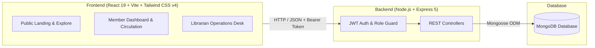

# 📚 Reader's Room

> A modern, full-stack library management and book circulation platform built for seamless patron borrowing, reservation queuing, and comprehensive administrative oversight.

[](https://nodejs.org/)
[](https://react.dev/)
[](https://expressjs.com/)
[](https://www.mongodb.com/)
[](https://tailwindcss.com/)
[](https://vitejs.dev/)

---

## 📖 Table of Contents

- [Overview](#-overview)
- [System Architecture](#-system-architecture)
- [Key Features](#-key-features)
  - [Public Portal](#1-public-portal)
  - [Member Portal](#2-member-portal)
  - [Librarian Admin Suite](#3-librarian-admin-suite)
- [Technology Stack](#-technology-stack)
- [Project Structure](#-project-structure)
- [Getting Started](#-getting-started)
  - [Prerequisites](#prerequisites)
  - [1. Backend Setup](#1-backend-setup)
  - [2. Frontend Setup](#2-frontend-setup)
- [Default Demo Credentials](#-default-demo-credentials)
- [Environment Variables](#-environment-variables)
- [API Reference Summary](#-api-reference-summary)
- [Submodule Documentation](#-submodule-documentation)
- [License](#-license)

---

## 🌟 Overview

**Reader's Room** is a full-featured, responsive web application engineered to bridge the gap between library patrons and administrators. It features an atmospheric, video-enhanced public landing page, an intuitive self-service portal for readers to discover and reserve literature, and an industrial-grade administration dashboard for librarians to manage circulation, multi-copy physical inventories with unique barcodes, members, and fines.



---

## 🚀 Key Features

### 1. Public Portal
- **Immersive Landing Experience**: Cinematic background video reel with dark/light atmospheric styling.
- **Catalog Preview**: Explore curated books across Nature, History, Science, and Fiction before signing in.
- **Self-Service Onboarding**: Streamlined user signup with automatic Member ID allocation (`MEM-xxxxx`).

### 2. Member Portal
- **Loan Tracking**: Active borrowings with real-time countdown badges (`Due today`, `x days left`, `Overdue by x days`) and visual progress indicators.
- **Self-Service Circulation**: Borrow books (up to 5 titles concurrently) for a 14-day borrowing cycle.
- **Renewals**: One-click 7-day extensions (up to 2 renewals per loan on non-overdue items).
- **Reservation Queue**: Queue for out-of-stock titles with live position calculation and instant pickup when ready.
- **Personal Wishlist & Reading History**: Curate reading lists and review historical checkouts and returns.
- **Profile & Preference Settings**: Update personal details, contact numbers, and security credentials.

### 3. Librarian Admin Suite
- **Analytics Dashboard**: Real-time KPI counters (Titles, Physical Copies, Active Loans, Registered Members, Overdue Notices, Pending Reservations), alongside a 6-day borrowing/return activity chart powered by Recharts.
- **Catalog & Inventory Control**:
  - Full CRUD lifecycle for titles with genre classification and shelf-location coordinates.
  - Granular copy tracking: Every copy gets a unique barcode (`LIB-xxxxx`), condition grade (`Good`, `Worn`, `Damaged`), and physical location.
  - Bulk CSV/JSON import and export tools.
  - Soft-archive capability for historical titles with active loan protections.
- **Circulation Desk**: Rapid issue and return terminal with barcode scanning simulation and real-time transaction auditing.
- **Member & Fines Administration**:
  - Directory of patrons with membership tier classifications (`Primary`, `Medium`, `Premium`).
  - Real-time account status toggle (`Active` vs `Suspended`).
  - Fine adjustment and payment ledger.
  - Patron reading metrics and average return turnaround calculations.

---

## 🛠️ Technology Stack

| Layer | Technologies |
| :--- | :--- |
| **Frontend Framework** | [React 19](https://react.dev/) + [Vite](https://vitejs.dev/) |
| **Styling & Design** | [Tailwind CSS v4](https://tailwindcss.com/) + Custom gradients & glassmorphism |
| **Client Routing** | [React Router v7](https://reactrouter.com/) (Nested routes, layout outlets, role-protected routes) |
| **Icons & Charts** | [Lucide React](https://lucide.dev/), [Recharts](https://recharts.org/) |
| **Backend Runtime** | [Node.js](https://nodejs.org/) (ES Modules) |
| **Web Framework** | [Express 5](https://expressjs.com/) |
| **Database & ODM** | [MongoDB](https://www.mongodb.com/) via [Mongoose 9](https://mongoosejs.com/) |
| **Authentication** | [JSON Web Tokens (JWT)](https://jwt.io/) + [bcryptjs](https://github.com/dcodeIO/bcrypt.js) |

---

## 📁 Project Structure

```text
Reader's Room/
├── Backend/                    # Express.js REST API & Database Models
│   ├── config/
│   │   └── db.js               # MongoDB connection handler
│   ├── middleware/
│   │   └── auth.js             # JWT verification and RBAC guards
│   ├── models/
│   │   ├── Book.js             # Book title catalog schema
│   │   ├── Copy.js             # Physical book copy schema (barcode & condition)
│   │   ├── Loan.js             # Circulation loan schema
│   │   ├── Reservation.js      # Hold and reservation queue schema
│   │   └── User.js             # User accounts and membership schema
│   ├── routes/
│   │   ├── auth.js             # Signup, login, and profile routes
│   │   ├── books.js            # Catalog & physical copy management
│   │   ├── librarian.js        # Analytics and circulation dashboard
│   │   ├── library.js          # Member borrow, return, reserve, wishlist
│   │   └── members.js          # Member management, status, and fines
│   ├── .env.example            # Environment template for Backend
│   ├── index.js                # API entry point & Express server configuration
│   ├── package.json            # Backend scripts and dependencies
│   ├── README.md               # Dedicated Backend documentation
│   └── seed.js                 # Database seeder with sample data
│
├── Frontend/                   # React 19 + Vite Single Page Application
│   ├── public/                 # Static assets (favicons, video reel)
│   │   ├── favicon.svg
│   │   ├── icons.svg
│   │   └── lib.MP4
│   ├── src/
│   │   ├── components/         # Reusable UI widgets and navigation
│   │   │   ├── About.jsx
│   │   │   ├── AppLayout.jsx
│   │   │   ├── AuthContext.jsx
│   │   │   ├── ExploreBooks.jsx
│   │   │   ├── Features.jsx
│   │   │   ├── LibrarianLayout.jsx
│   │   │   ├── Login.jsx
│   │   │   ├── Navbar.jsx
│   │   │   ├── Page.jsx
│   │   │   ├── ProtectedRoute.jsx
│   │   │   ├── Sidebar.jsx
│   │   │   ├── Signup.jsx
│   │   │   └── ui.jsx
│   │   ├── context/
│   │   │   └── LibraryContext.jsx  # Global patron state & action dispatchers
│   │   ├── pages/              # Member & Librarian view views
│   │   │   ├── BrowseBooks.jsx
│   │   │   ├── CatalogInventory.jsx
│   │   │   ├── CirculationDesk.jsx
│   │   │   ├── LibrarianDashboard.jsx
│   │   │   ├── MembersFines.jsx
│   │   │   ├── MyLibrary.jsx
│   │   │   ├── Overview.jsx
│   │   │   ├── ReadingHistory.jsx
│   │   │   ├── Reservations.jsx
│   │   │   ├── Settings.jsx
│   │   │   ├── SettingsPreferences.jsx
│   │   │   └── Wishlist.jsx
│   │   ├── api.js              # Fetch client with Bearer token injection
│   │   ├── App.jsx             # Router and layout definitions
│   │   ├── index.css           # Global Tailwind and font definitions
│   │   └── main.jsx            # Application DOM mount
│   ├── .env.example            # Environment template for Frontend
│   ├── package.json            # Frontend dependencies & Vite scripts
│   ├── README.md               # Dedicated Frontend documentation
│   └── vite.config.js          # Vite build and Tailwind plugin config
│
├── .gitignore                  # Monorepo git ignore rules
└── README.md                   # Master Project Documentation (This file)
```

---

## ⚡ Getting Started

### Prerequisites

Ensure you have the following installed on your development workstation:
- **Node.js**: `v18.0.0` or higher
- **npm** (comes with Node.js) or **pnpm**
- **MongoDB**: A running local MongoDB instance or a [MongoDB Atlas](https://www.mongodb.com/cloud/atlas) connection URI

---

### 1. Backend Setup

1. Open a terminal and navigate to the `Backend` directory:
   ```bash
   cd Backend
   ```

2. Install dependencies:
   ```bash
   npm install
   ```

3. Create your environment configuration:
   ```bash
   cp .env.example .env
   ```
   *Edit `.env` to configure your MongoDB connection string and secret key:*
   ```env
   PORT=5000
   JWT_SECRET=your_jwt_secret_key_change_in_production
   MONGO_URI=mongodb://localhost:27017/readersroom
   ```

4. Seed the database with initial books, member accounts, and librarian credentials:
   ```bash
   npm run seed
   ```

5. Start the backend development server:
   ```bash
   npm run dev
   ```
   *The API will be live at `http://localhost:5000`.*

---

### 2. Frontend Setup

1. Open a new terminal window and navigate to the `Frontend` directory:
   ```bash
   cd Frontend
   ```

2. Install dependencies:
   ```bash
   npm install
   ```

3. Configure frontend environment variables:
   ```bash
   cp .env.example .env
   ```
   *Ensure the backend API URL matches:*
   ```env
   VITE_API_URL=http://localhost:5000
   ```

4. Launch the Vite development server:
   ```bash
   npm run dev
   ```
   *The application will be accessible at `http://localhost:5173`.*

---

## 🔑 Default Demo Credentials

When you run `npm run seed` in the Backend, the database is populated with the following preconfigured accounts:

| Role | Email Address | Password | Account Details |
| :--- | :--- | :--- | :--- |
| **Librarian** | `marcus@library.org` | `librarian123` | Full administrative privileges, catalog editing, circulation desk, members audit |
| **Member** | `alexander@example.com` | `password123` | Member ID: `MEM-99201`, borrowing, reservation, and wishlist access |

> Patrons can also register a brand new account anytime via the **Signup** page (`/signup`).

---

## ⚙️ Environment Variables

### Backend (`Backend/.env`)
| Variable | Description | Default / Example |
| :--- | :--- | :--- |
| `PORT` | Port number the Express API server listens on | `5000` |
| `JWT_SECRET` | Secret key used to sign and verify JSON Web Tokens | `readers_room_secret_key_2026` |
| `MONGO_URI` | MongoDB connection connection string (Local or Atlas) | `mongodb://localhost:27017/readersroom` |

### Frontend (`Frontend/.env`)
| Variable | Description | Default / Example |
| :--- | :--- | :--- |
| `VITE_API_URL` | Base URL pointing to the running backend service | `http://localhost:5000` |

---

## 📡 API Reference Summary

The API is prefixed with `/api` and enforces JSON payloads with JWT Bearer Authentication.

```text
Authentication      POST   /api/auth/signup         Register new member
                    POST   /api/auth/login          Authenticate user and issue JWT
                    GET    /api/auth/me             Get current user profile
                    PUT    /api/auth/me             Update profile details
                    PUT    /api/auth/password       Update user password

Catalog & Copies    GET    /api/books               List active books (or all if librarian)
                    POST   /api/books               Create new book with auto-generated copies [Librarian]
                    POST   /api/books/bulk          Bulk CSV/JSON catalog import [Librarian]
                    PUT    /api/books/:id           Update book metadata [Librarian]
                    PATCH  /api/books/:id/archive   Archive or restore book [Librarian]
                    DELETE /api/books/:id           Remove title if no active loans exist [Librarian]
                    GET    /api/books/:id/copies    List physical copies of a title [Librarian]
                    POST   /api/books/:id/copies    Add physical copy record [Librarian]
                    PATCH  /api/books/copies/:copyId Update copy status/condition [Librarian]
                    DELETE /api/books/copies/:copyId Delete physical copy [Librarian]

Member Library      GET    /api/library             Fetch active loans, reservations, history & wishlist
                    POST   /api/library/borrow/:id  Borrow a book copy (14 days, max 5 books)
                    POST   /api/library/renew/:id   Renew active loan (+7 days, max 2 renewals)
                    POST   /api/library/return/:id  Return a borrowed book
                    POST   /api/library/reserve/:id Reserve an unavailable book
                    DELETE /api/library/reserve/:id Cancel existing reservation
                    POST   /api/library/pickup/:id  Claim and checkout ready reservation
                    POST   /api/library/wishlist/:id Toggle book in member wishlist

Admin Analytics     GET    /api/librarian/dashboard Statistics, trends, overdues & queues [Librarian]

Member Management   GET    /api/members             List members with loan counts [Librarian]
                    POST   /api/members             Create member account [Librarian]
                    PUT    /api/members/:id         Edit member details [Librarian]
                    PATCH  /api/members/:id/status  Toggle member status (Active / Suspended) [Librarian]
                    PATCH  /api/members/:id/fines   Update fine balance [Librarian]
                    GET    /api/members/:id/details Detailed borrowing habits and metrics [Librarian]
```

---

## 📑 Submodule Documentation

For in-depth setup guidelines, component breakdowns, architecture diagrams, and development practices specific to each layer, please consult the dedicated documentation:

- 🎨 **[Frontend Documentation](Frontend/README.md)**: Component trees, state management (`LibraryContext`), Tailwind theme customization, routing architecture, and Vite optimization.
- ⚙️ **[Backend Documentation](Backend/README.md)**: Mongoose schemas, barcode generation algorithms, authentication flow, business logic restrictions, and endpoint payloads.

---

## 📄 License

This project is licensed under the [ISC License](LICENSE). Feel free to use, modify, and distribute it for academic, community, or commercial library installations.
